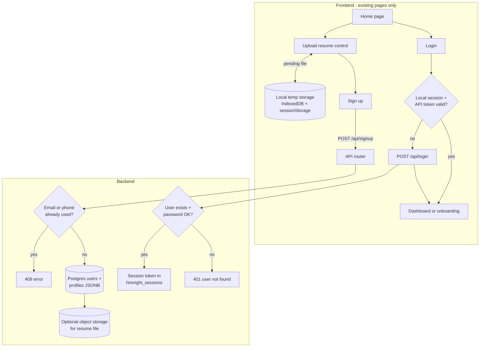

# Application auth & resume onboarding workflow (agent spec)

**Audience:** AI coding agents implementing or repairing the end-to-end flow in the architecture diagram (Home → resume upload → sign up / login → dashboard), **on top of the existing HireRight codebase**.

**Hard constraints**

1. **Do not change UI** — no edits to layout, CSS modules, copy, or visual components (`*.module.css`, marketing pages, form structure). You may only adjust **non-visual wiring** (handlers, redirects, API calls) inside existing pages when unavoidable; prefer new logic in `frontend/src/lib/**` and `backend/node/**`.
2. **Minimal diff** — touch only files required for this workflow. Do not refactor unrelated features (interviews, employer dashboard, assessments) unless a shared auth helper forces a one-line import change.
3. **Environment** — required keys are listed below. If a key needed for a step you are implementing is **missing**, **stop and ask the user** for it; do not invent placeholders or disable security checks silently.
4. **Preserve existing routes** — frontend paths stay `/`, `/signup`, `/login`, `/onboarding`, `/dashboard`. Backend stays `POST /api/signup`, `POST /api/login` (diagram label “signin” = **`/api/login`** in this repo).

---

## 1. Target workflow (diagram)

**Post-login routing (job seeker, no UI change)**

| Condition | Navigate to |
|-----------|-------------|
| `sessionStorage hireright.intent === 'upload_resume'` | `/onboarding` (resume auto-attached in wizard) |
| Profile incomplete (`completedSteps < 3`) | `/onboarding` |
| Otherwise | `/dashboard` |
| Employer role | `/employer/dashboard` |

Logic today lives in `navigateAfterLogin()` inside `frontend/src/pages/AuthPages.tsx` — **reuse** it; do not duplicate redirect rules elsewhere.

---

## 2. What already exists (do not rebuild)

| Diagram step | Current implementation |
|--------------|------------------------|
| Home → upload resume | `frontend/src/pages/HomePage.tsx` → `setPendingResume()` |
| Temp resume storage | `frontend/src/lib/pendingResume.ts` (IndexedDB `hireright_storage`, keys `hireright.pendingResumeMeta`, intent `hireright.intent`) |
| Sign up UI | `frontend/src/pages/AuthPages.tsx` (`SignupPage`, `/signup`) |
| Login UI | `frontend/src/pages/AuthPages.tsx` (`LoginPage`, `/login`) |
| Local “session cookie” | `localStorage`: `hireright.session`, `hireright.users`, `hireright.apiToken` (`frontend/src/lib/store.ts`, `frontend/src/lib/api.ts`) |
| Sign up → login redirect | After successful signup, navigate to `/login` with prefilled email/password (intentional product rule in code) |
| POST signup | `backend/node/index.mjs` → `registerAccount()` in `backend/node/authRegister.mjs` |
| Duplicate email/phone | Postgres unique constraints + 409 responses; `findUserByPhone`, email check in signup handler |
| POST login / session | `POST /api/login` → `registerSession()` → Bearer token; `GET /api/me` validates token |
| Password hashing | scrypt in `backend/node/authPasswords.mjs` |
| Resume attach after auth | `frontend/src/components/ResumeUpload.tsx` reads `getPendingResume()` on mount |
| Resume text extraction | `POST /api/resume/parse`, `frontend/src/lib/resumeParser.ts` |
| Profile persistence | `PUT /api/profile` → Postgres `profiles.data` JSONB |
| Protected routes | `frontend/src/components/RequireAuth.tsx` |

**Not fully aligned with diagram (agent work items)**

1. **Login “check local storage first”** — Diagram: if auth already in local storage, go to dashboard **without** calling backend. Today: user must submit login form; `RequireAuth` redirects unauthenticated users but **login page does not auto-skip** when session + token are already valid.
2. **Resume on CDN at signup** — Diagram: store file in **CDN (e.g. Supabase Storage)** at signup. Today: file stays in **browser** until onboarding; Postgres holds **parsed text** in profile JSON, not necessarily a durable file URL.
3. **“Extracted data” at signup** — Diagram implies persistence at signup. Today: extraction runs during **onboarding** after login when resume is parsed.
4. **Single backend path for signin** — Some flows still use **local-only** users in `hireright.users` without Postgres; `ensureApiSession()` tries to sync — agent should ensure **job seeker signup/login always hits Postgres** when `DATABASE_URL` is set.

---

## 3. Required environment variables

Ask the user for any **missing** variable before implementing the dependent step.

### Always required (backend auth + signup)

| Key | Purpose |
|-----|---------|
| `DATABASE_URL` | Postgres (Neon); users, sessions, profiles |
| `SESSION_SECRET` | Session signing (≥ 32 chars in production) |
| `PORT` | API port (default `8787`) |
| `CORS_ORIGINS` | Must include Vite origin (e.g. `http://localhost:5173`) |

### Frontend → API

| Key | Purpose |
|-----|---------|
| `VITE_API_URL` | Empty in dev = Vite proxy to backend; set in production |
| `VITE_AUTH_PROVIDER` | Use `api` so auth is validated against Node API (recommended for this workflow) |

### Optional — Supabase auth mirror (only if user enables Supabase)

| Key | Purpose |
|-----|---------|
| `VITE_SUPABASE_URL` | Supabase project URL |
| `VITE_SUPABASE_ANON_KEY` | Client anon key |

### Optional — resume **file** storage on CDN (diagram “Supabase storage”)

Implement only if the user confirms they want **binary resume storage**, not just profile text.

| Key | Purpose |
|-----|---------|
| `SUPABASE_URL` | Same project URL (server-side) |
| `SUPABASE_SERVICE_ROLE_KEY` | Server upload to storage bucket (never expose to frontend) |
| `SUPABASE_RESUME_BUCKET` | Bucket name (e.g. `resumes`) |

If the user wants CDN storage but any of these three are missing, **ask** before coding.

### Not part of this workflow

Interview confirmation email (`SMTP_EMAIL`, `SMTP_APP_PASSWORD`, etc.) — ignore unless the user expands scope.

---

## 4. Implementation plan (ordered)

### Phase A — Local session short-circuit (login page)

**Goal:** Match diagram: on `/login` (and optionally `/signup` if already logged in), if local session is valid, redirect without POST `/api/login`.

**Allowed files**

- `frontend/src/lib/authSession.ts` (create) — central helpers:
  - `hasLocalSession(): boolean` — `getUser()` from store
  - `isApiSessionValid(): Promise<boolean>` — `getApiToken()` + `apiMe()` email matches `getUser()?.email`
  - `resolveAuthenticatedDestination(user): string` — mirror rules from `navigateAfterLogin` without importing React (duplicate small redirect table or export pure function from a shared module)
- `frontend/src/pages/AuthPages.tsx` — **one** `useEffect` on mount calling the helper and `navigate()` (no UI changes)
- Optionally `frontend/src/lib/apiSession.ts` — reuse validation logic; avoid duplication

**Acceptance**

- Logged-in user with valid Bearer token visiting `/login` lands on `/dashboard` or `/onboarding` per existing rules within 1s.
- Invalid/expired token clears `hireright.apiToken` and shows login form (no infinite redirect).

### Phase B — Signup/login always backed by Postgres

**Goal:** After signup, user exists in `users` with hashed password; login uses `POST /api/login` successfully.

**Allowed files**

- `frontend/src/lib/apiSession.ts` — already registers local-only users on API; ensure signup path in `AuthPages` always calls `apiSignup` when `apiHealth()` is true
- `backend/node/index.mjs` — only if signup/login errors need clearer 409 messages (no route renames)

**Acceptance**

- New signup with unique email/phone → 201 → login with same credentials → 200 + token.
- Duplicate email → 409 with message indicating email or phone already used (match diagram error intent).

**Do not** store plaintext passwords in Postgres (hash only — already done).

### Phase C — Pending resume through auth (browser → profile)

**Goal:** Home upload → signup → login → onboarding with resume pre-loaded (already mostly works); harden edge cases.

**Allowed files**

- `frontend/src/lib/pendingResume.ts`
- `frontend/src/components/ResumeUpload.tsx` (logic only)
- `frontend/src/lib/resumeParser.ts`
- `frontend/src/lib/apiSync.ts` / `apiSaveProfile`

**Tasks**

1. Ensure `hireright.intent` is **not** cleared until successful navigation to onboarding (today cleared in `navigateAfterLogin` — keep that timing).
2. After first successful parse in onboarding, `PUT /api/profile` with `resumeText`, `resumeName`, and any extracted fields the wizard already uses.
3. Call `clearPendingResume()` only after successful attach (already in `ResumeUpload.tsx`).

**Acceptance**

- E2E path: upload on home → signup → login → step 1 shows resume without second upload.

### Phase D — Optional CDN resume storage (diagram Supabase box)

**Only if user provided Supabase storage env keys.**

**Allowed files**

- `backend/node/resumeStorage.mjs` (create) — upload buffer, return `storagePath` or public/signed URL
- `backend/node/index.mjs` — e.g. `POST /api/resume/upload` (auth required), max 2 MB, pdf/docx
- Extend `profiles.data` JSON with `resumeStoragePath` / `resumeUrl` (no schema migration required — JSONB)

**Frontend:** after login, if `getPendingResume()` returns a file, optionally POST file to new endpoint **before or after** parse — prefer **after** auth so Bearer token is present. Wire from `ResumeUpload.tsx` or a small `frontend/src/lib/resumeUploadApi.ts` helper.

**Acceptance**

- File retrievable from storage; profile JSON references it; UI unchanged.

---

## 5. Files you must not modify (unless user explicitly overrides)

- `frontend/src/pages/*.module.css`, `frontend/src/components/*.module.css`
- Marketing copy and structure on `HomePage.tsx` (except import/handler lines for auth wiring if strictly necessary)
- `frontend/src/motion/**`, theme CSS
- Unrelated backend: assessment engine, interview agent prompts, vendor ATS scoring

---

## 6. API contract reference (keep stable)

### `POST /api/signup`

Body: `{ name, email, password, phone, role?, companyName? }`

- 201: `{ token, user }` — token may be present; product still sends user to `/login`.
- 409: duplicate email or phone.
- 400: validation (email format, phone 10–15 digits, password length).

### `POST /api/login`

Body: `{ email, password, expectedRole? }`

- 200: `{ token, user }` — store token in `hireright.apiToken`.
- 401: invalid credentials (diagram: “user does not exist” / wrong password — same user-facing message policy as today).

### `GET /api/me`

Header: `Authorization: Bearer <token>`

- 200: `{ user: { email, ... } }` — used to validate token matches local session email.

### `PUT /api/profile`

Authenticated; persists wizard JSON including resume fields.

---

## 7. Local storage keys (diagram “cookies”)

| Key | Role |
|-----|------|
| `hireright.session` | Current user email |
| `hireright.users` | Local mirror of user records (includes password for API re-login — existing behavior) |
| `hireright.apiToken` | Bearer session id |
| `hireright.intent` | `upload_resume` when coming from home upload |
| IndexedDB `hireright_storage` / `pending_resume` | Binary resume awaiting onboarding |

Do not rename these without a migration helper in `store.ts`.

---

## 8. Verification checklist (agent must run)

1. **Backend unit tests:** `npm test` in `backend/node` (no new failures).
2. **Signup duplicate:** same email twice → 409.
3. **Login invalid:** wrong password → 401.
4. **Resume path:** manual or script: set pending resume → signup → login → confirm profile API receives `resumeText` after onboarding step 1 processing.
5. **Session short-circuit:** with valid session, `GET /login` redirects away without POST login.

Optional CDN phase: upload endpoint returns 401 without token; 200 with token and file stored.

---

## 9. Agent execution checklist

Before coding:

- [ ] Read this file and skim `frontend/src/pages/AuthPages.tsx` (`navigateAfterLogin`, signup submit, login submit).
- [ ] Confirm `DATABASE_URL` and `VITE_AUTH_PROVIDER` with user if not in `.env`.
- [ ] Confirm whether **Phase D (CDN storage)** is in scope; if yes, collect Supabase storage keys.

While coding:

- [ ] No UI/CSS/copy changes.
- [ ] Smallest diff per phase.
- [ ] Ask user for missing env keys instead of guessing.

After coding:

- [ ] Run backend tests.
- [ ] Document any new env keys in `.env.example` only (never commit real secrets).

---

## 10. Reference diagram asset

Source whiteboard: `assets/c__Users_guntu_AppData_Roaming_Cursor_User_workspaceStorage_1dc4394633e16178aed85ea86293c7af_images_image-a08bedec-b485-4c3c-b762-25988256967c.png` (repo-relative path may vary; use the diagram in this document as canonical).

---

## 11. Glossary

| Diagram term | Codebase term |
|--------------|----------------|
| signin | `POST /api/login` |
| cookies / local auth | `localStorage` session + `hireright.apiToken` |
| dashboard | `/dashboard` (job seeker) or `/employer/dashboard` |
| extracted data | Parsed resume fields in profile JSON + optional LLM parse via `/api/resume/parse` |
| Postgres | Neon via `DATABASE_URL` |
| CDN | Optional Supabase Storage (Phase D) |
