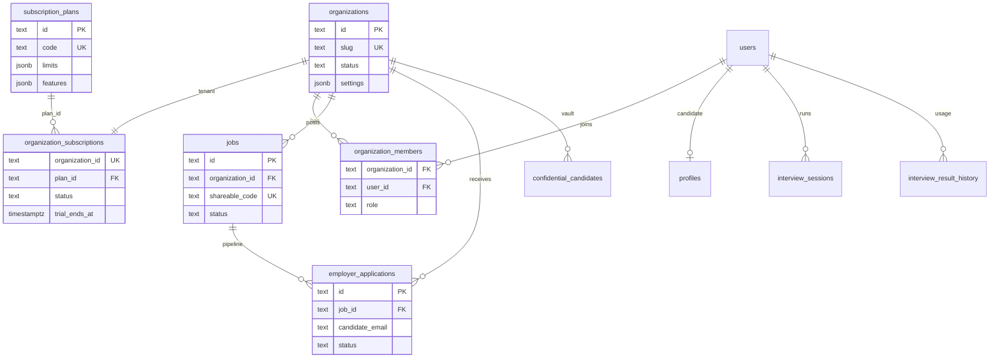

# HireRight database (Neon PostgreSQL — SaaS)

Multi-tenant hiring platform: **organizations** (tenants), **subscription plans**, **team RBAC**, **jobs**, **applications**, and **AI interviews**.

## SaaS entity model

## Roles

| Layer | Values |
|--------|--------|
| **Platform user** (`users.role`) | `jobseeker` · `employer` |
| **Tenant member** (`organization_members.role`) | `owner` · `admin` · `recruiter` · `member` · `viewer` |

Employer signup automatically creates:

1. `organizations` row (workspace from company name)
2. `organization_members` row (`owner`)
3. `organization_subscriptions` row (`trialing`, **Starter** plan, 14-day trial)

## Subscription plans (seeded)

| ID | Code | Typical use |
|----|------|-------------|
| `plan-free` | free | Solo recruiter |
| `plan-starter` | starter | Default trial |
| `plan-pro` | pro | Agencies |
| `plan-enterprise` | enterprise | Custom / platform |

`limits` JSON keys: `seats`, `active_jobs`, `interviews_per_month`, `vault_candidates`.

Stripe columns (`stripe_customer_id`, `stripe_subscription_id`) are ready for billing integration.

## API surfaces (Node)

| Endpoint | Purpose |
|----------|---------|
| `GET /api/plans` | Public plan catalog |
| `GET /api/me` | User + `organization`, `subscription`, `plan`, profile |
| `GET /api/organization` | Tenant dashboard payload (members, jobs) |
| `GET /api/talent/search` | **Employer:** search job seekers (`q`, `skills`, `location`, `minScore`) |
| `GET /api/talent/candidates/:userId` | **Employer:** candidate detail + interview |

### Employer talent search tables

| Table | Purpose |
|-------|---------|
| `candidate_talent_profiles` | Searchable candidate row (FTS `search_vector`, skills[], scores) |
| `organization_talent_access` | Extra visibility when candidate applied to your org |
| `recruiter_saved_searches` | Saved filter presets (future UI) |

Visibility: `marketplace` (all employers), `organization_only` (needs access row), `private` (hidden).

## Auth

- `/api/signup` · `/api/login` with Bearer tokens in `hireright_sessions`.
- Passwords: salted SHA-256 in `users.password_hash`.

## Setup (Neon)

1. Set `DATABASE_URL` in **repo-root** `.env` (copy from `.env.example`, append `?sslmode=require` if needed).
2. `npm run db:init` from `backend/node` (or start API — schema applies on boot).
3. Demo employers get tenants seeded on first boot when `ALLOW_DEMO_ACCOUNTS=true`.

## Notes

- **JSONB** is used inside Postgres for flexible profile/scorecard payloads — not flat files.
- Candidate apply list still uses `job_applications` (per-email) until employer APIs fully replace localStorage jobs.
- Platform org `org-platform` holds global demo vault data.
