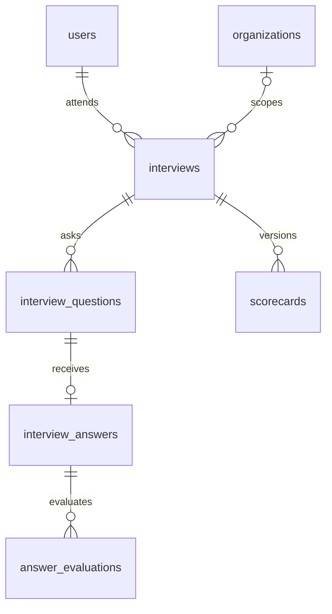
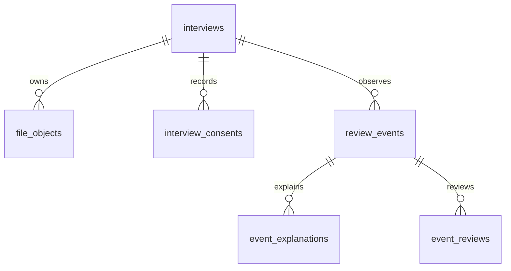

# HireRightt: Neon relational database design

Status: reviewed against the current Node source on 22 October 2026, including portability to Amazon RDS for PostgreSQL. This is a concrete schema design and validation package, **not a production migration or a completed application cutover**. No live Neon rows or S3 objects have been changed. The application continues using its existing schema and report format.

## Storage boundary

| Information | S3 | Neon |
|---|---|---|
| Original résumé | PDF/DOCX bytes, immutable versions | Owner, file ID, bucket/key/version, size/type, parsing state |
| Parsed résumé | Optional extraction artifact | Text needed for questions/search, structured analysis, parser/model version |
| Interview recording/audio | Private video/audio bytes | Interview/owner/tenant, duration, upload state, consent and object reference |
| Transcript | Downloadable transcript JSON/text | Individual questions and answers needed for scoring, recovery and review |
| Report | Exact generated PDF | Structured scorecard, rubric results, feedback, report version and file reference |
| Camera checks and events | Optional recording used for playback | Type, timestamp, offset, duration, uncertainty, explanation and human review |
| Product data | No | Accounts, roles, tenants, jobs, applications, invitations, subscriptions, search/access, audit and usage |

S3 is the binary artifact store. Neon is the transactional system of record. Keeping answer text and structured results in Neon is intentional: dashboards should not download and parse large S3 objects for every query. A PDF report and the JSON used to render it are different representations. Do not delete the JSON because a PDF exists.

Current S3 uploads are configuration-dependent. Source code alone cannot establish that every existing report, résumé or transcript has a successful S3 upload. Metadata reconciliation must check actual objects before legacy content is removed.

## What exists today: all 35 tables

The inventory comes from `backend/node/db/applySchema.mjs` and its five SQL files, checked against repository and route code. It is not a live database inspection.

| Domain | Existing tables | Responsibility and target decision |
|---|---|---|
| Identity | `users`, `hireright_sessions` | Keep users and login behavior. Later migrate bearer tokens to hashes and stable user IDs without invalidating sessions unexpectedly. |
| Tenants | `organizations`, `organization_members`, `organization_invites` | Keep workspaces, membership roles and team invitations. Membership, not primary organization alone, authorizes tenant access. |
| Billing | `subscription_plans`, `organization_subscriptions` | Keep plan catalog, limits, features, current subscription and provider references. Do not invent an invoice/payment ledger before a payment workflow exists. |
| Profiles | `profiles` | Currently a large JSON document keyed by email. Replace operational reads incrementally with candidate profile tables below. Preserve every original payload during migration. |
| Jobs/applications | `jobs`, `employer_applications`, `job_applications` | Keep tenant jobs and employer applications. Candidate-side job applications are a second representation; reconcile IDs/status before replacing them with a query/view over employer applications. Keep unmatched external/legacy applies. |
| Main interview | `interview_sessions`, `interview_results`, `interview_result_history` | Runtime JSON, latest result per email, historical results. Migrate to one interview identity and versioned scorecards; never collapse history into one latest row. |
| Talent marketplace | `candidate_talent_profiles`, `organization_talent_access`, `recruiter_saved_searches`, `confidential_candidates` | Keep search projection, explicit access grants, saved filters and tenant vault. Search projection is a rebuildable index, not a second source of profile truth. |
| Scheduled interviews | `interview_invites` | Keep scheduling window, email delivery state and résumé/JD context snapshot; distinct from team invites. |
| Structured planning | `assessment_jobs`, `assessment_resumes`, `interview_plans`, `interview_questions` | Preserve existing separate assessment flow, snapshots, approved plans, competencies, extraction state and model versions. Converge only after parity tests. |
| Structured execution | `assessment_sessions`, `interview_answers`, `answer_evaluations`, `recruiter_reviews`, `interview_reports` | Existing transactional workflow and rubric scoring remain active until adapters use the proposed unified interview tables. |
| Assessment linkage/operations | `personalized_interview_links`, `assessment_events`, `assessment_usage` | Preserve request idempotency, personal/job/application links, event history, tokens, model and latency. These are not unused tables. |
| File metadata | `stored_files`, `interview_recordings`, `interview_artifacts` | Consolidate into one file registry after access/download adapters and object verification pass. Keep provider, bucket and exact object keys. |
| Audit | `audit_logs` | Keep actor, tenant, action, entity and time. Record recording access and sensitive mutations; do not put tokens or complete résumé text in audit metadata. |

Additional existing data lives inside JSON: ATS/JD evaluations, candidate contact snapshots, pipeline notes, interview questions/answers, scorecard display fields, résumé extraction, review events and explanations. The migration archive and field mapping below prevent these from being silently discarded.

## Problems the design addresses

1. `store.mjs` loads global collections and saves whole snapshots; it deletes/reinserts job applications and confidential candidates and removes missing employer applications/jobs. Concurrent server instances can overwrite newer state. Adding tables alone does not fix this: replace snapshot writes with tenant-scoped repositories before cutover.
2. Main results use email as the latest-result key. Email is mutable and one candidate can have multiple interviews. Use user ID for identity and interview ID for each attempt; keep a latest-scorecard query for dashboard compatibility.
3. Main session/result writers do not consistently populate relational organization/application columns even when JSON carries context. Resolve ownership from the authoritative job/application and verified membership; do not blindly trust JSON or the upload's tenant value.
4. Recording/artifact references have no database FK to one canonical interview. The proposal binds files and explanations to the same candidate/interview and checks tenant equality, including personal scope.
5. S3 `platform` (or configured default) is not the same string as database `org-platform`. Personal interviews use NULL organization in the new model; S3 paths are storage locations, not access grants.
6. Node and Python contain different definitions of similarly named tables. The Node SQL is the authority for this application. Do not run the Python Alembic initial migration against the same schema without a separate reconciliation.
7. Startup runs schema SQL. Versioned deploy migrations with checksums and a dedicated migration role should replace startup DDL after the current flows are migrated.

## Proposed relational expansion

`backend/node/db/design/schema-v2.sql` is PostgreSQL DDL intended for branch validation. It adds a `hiring` namespace with 23 tables and two supporting unique indexes on existing tables. Existing identity, tenant, billing, job, application, talent, scheduling, audit and usage tables remain in `public`. This is an expand/contract design: the temporary overlap is deliberate, not the final steady-state architecture. The complete design consists of the five existing SQL files listed in `applySchema.mjs` plus this expansion; the expansion is not a replacement bootstrap script.

Existing opaque TEXT IDs remain unchanged. New entities use UUIDs. All instants use `timestamptz`; dates use `date`; elapsed video times use integer milliseconds. Score scales are explicit because the current workflows use different scales. Core relationships and frequently filtered fields are relational; versioned model outputs, rubric structures and exact report snapshots remain JSONB.

| Proposed table | Main key / relationship | Contents |
|---|---|---|
| `candidate_profiles` | user ID → users | Role, experience, location, summary, motivation, availability, preferences summary, wizard progress, visibility, version |
| `candidate_skills` | candidate + skill | Ordered skill list |
| `work_experiences` | UUID → candidate | Employer, role, dates, responsibilities and source item ID |
| `projects` | UUID → candidate | Project description, contribution, technologies, outcome and source |
| `certifications` | UUID → candidate | Name, issuer, credential, earned date |
| `profile_highlights` | UUID → candidate | Achievements, awards and performance metrics |
| `candidate_preferences` | candidate + kind + value | Preferred roles and locations |
| `interviews` | UUID → candidate, optional tenant/job/application | Attempt identity, original workflow/session ID, state, model versions and question-plan snapshot |
| `file_objects` | UUID → owner and optional interview | S3/Supabase location, immutable version reference, category, upload state, duration and checksum |
| `resume_parses` | UUID → file | Parser version, extraction/analysis, review state, expiry and error code |
| `interview_questions` | UUID → interview; unique position | Exact question, source ID, category, skill/topic, difficulty and rubric |
| `interview_answers` | UUID → question + interview | Answer text, submitted/skipped state, timing and retry request ID |
| `answer_evaluations` | UUID → answer; unique version | Score/max score, feedback, rubric components and model/prompt versions |
| `evaluation_reviews` | UUID → evaluation + reviewer | Human score correction, reason, time; retain original evaluation |
| `scorecards` | UUID → interview; unique version | Overall score and exact immutable report rendering snapshot |
| `scorecard_files` | scorecard + file; matching interview | Exact PDF object associated with a scorecard version; rejects recordings and files from other interviews |
| `interview_consents` | UUID → interview | Append-only grant/decline history for camera checks and recording, notice version |
| `camera_checks` | UUID → interview | Preflight result, lighting/positioning, device availability and detector version |
| `review_events` | interview + event ID | Event type, timestamp, offset and duration; uncertainty is a first-class type |
| `event_explanations` | UUID → event + owning candidate | Candidate explanation history |
| `event_reviews` | UUID → event + reviewer | Human disposition and notes, independent of scores |
| `outbox` | UUID; unique idempotency key | Retryable S3/email/background-work messages committed alongside domain changes |
| `legacy_records` | source table + key | Temporary migration archive, exact unmapped payload and reconciliation status |

No artificial six-question constraint is added: the main interview currently uses six questions while the separate structured assessment supports seven positions. The planner controls the sequence and stores its version. This preserves both flows and your current questioning model.





## Profile mapping: preserve every wizard field

| Current fields | Proposed destination |
|---|---|
| `fullName`, `name`, email, phone | Existing user identity; resolve conflicting snapshot names without overwriting verified identity |
| `whoAreYou`, `whatDrivesYou`, `keyStrengths` | Profile introduction, motivation, strengths |
| `currentRole`, `totalExperience`, `currentLocation`, `experienceSummary` | Current role, original experience label, location, summary |
| `noticePeriod`, `selfRating`, `workMode`, `salaryExpectation`, `interviewNotes` | Corresponding profile columns; preserve salary text instead of guessing currency/range |
| `completedSteps`, `updatedAt` | Wizard progress and timestamp |
| `skills`, `workExperiences`, `certifications` | Corresponding ordered child rows, retaining source item IDs |
| `achievements`, `awards`, `metrics` | Highlights with description, contribution, impact, time period |
| `preferredRoles`, `preferredLocations` | Preference rows |
| `resumeFileId`, `resumeName`, `storageProvider`, `resumeStoragePath`, `resumeUrl` | Reconciled file metadata; archive legacy URL, never use a public URL to authorize downloads |
| `resumeText` and assessment extraction/analysis | Versioned résumé parse linked to the exact file version |
| Projects extracted from résumé | Project rows with source `resume`; not fabricated from missing wizard fields |
| Unknown or incompatible fields/date labels | Exact `legacy_records.payload`, status `needs_review`; do not coerce silently |

## Tenant access and integrity

Tenant-scoped queries must derive tenant from the authenticated user and active membership. Candidate profiles are global user-owned records; employers receive explicit access through applications or talent grants. A candidate applying to two employers must not give either employer access to the other's interview/report history.

| Resource | Candidate | Vendor | Platform operations |
|---|---|---|---|
| Profile/résumé | Own | Explicit application/talent grant | Explicit audited privilege |
| Questions/answers/results | Own, according to product workflow | Matching tenant/application with permitted role | Explicit audited privilege |
| Recording/audio | No playback access | Matching tenant, permitted reviewer role, valid recording availability/consent | No implicit override; separately authorized audited access |
| Camera events | Own, with explanation submission | Matching tenant, permitted reviewer role | Explicit audited privilege |
| Billing/team management | No | Owner/admin as appropriate | Explicit audited privilege |

The DDL enforces matching application/job/tenant/candidate references, file ownership, event ownership, nonnegative timings, version uniqueness and retry uniqueness. It enables RLS with **no policies or grants** on new tables: non-owner runtime roles are denied by default. This is a safe staging state, not a finished runtime authorization implementation. The database owner can bypass RLS; do not run the final API as the migration owner. Before cutover, implement and test policies using a non-owner, non-BYPASSRLS API role and transaction-local authenticated context. Never reuse pooled tenant context outside its transaction.

The DDL also prevents changes to file ownership/object identity and existing scorecards/evaluations, checks review scores against the original evaluation scale, requires original resume files for parsing, and prevents duplicate parses even when the parser version is unknown. The runtime adapters must additionally enforce reviewer membership/role, consent before capture, and append-only review/consent histories. Retention deletions need a separate privileged workflow; update protection is not deletion protection. Existing roles receive no access to the new tables from this script. A FK proves a relationship, not permission to read it.

Files are served using short-lived signed URLs after authorization. Store bucket/key/version rather than signed URLs. Camera markers seek into the recording using elapsed time; separate clip files are optional and not required for every event. `UNABLE_TO_ASSESS` is not proof of cheating, and no review table updates a scorecard.

## Migration and rollback plan

1. Create a Neon development branch; use a schema-only branch plus sanitized fixtures if production data is inappropriate for testing. Run existing `db:verify`, then `design/preflight.sql`. Resolve every ownership mismatch and orphan; keep an exception ledger for unresolvable historical records.
2. Establish source row counts and checksums by table, candidate and tenant. Record the deployed schema/version and backup recovery point. Confirm no Python migration process targets this database.
3. Validate the new DDL with the rollback-only script below. Apply it to the branch with a versioned migration ledger/checksum. It is intentionally excluded from normal `db:init` and application startup.
4. Replace global snapshot persistence with scoped repositories and per-entity optimistic concurrency. Each operation must use one transaction/client. Preserve response shapes consumed by the current frontend. Do this before dual writes; otherwise a stale snapshot can delete migrated parents.
5. Backfill candidate identities/profiles and verified file metadata first, then interviews, questions/answers, evaluations, scorecards and events. Identify source records by `(workflow, source_session_id)`; retries must not create duplicate attempts. Convert offsets from seconds to milliseconds once. Do not manufacture event durations, consent records or session IDs for historical rows that lack them.
6. Resolve session tenant through job/application links and candidate identity. Keep employer assets tenant-owned and personal assets personal. Unknown or conflicting cases stay private in the exception archive until resolved. Never assign them to an arbitrary default employer.
7. Preserve all historical report snapshots exactly and attach existing PDF object/version references. If a historical S3 key was overwritten and versioning was disabled, previous bytes cannot be reconstructed from schema changes. Preserve available JSON and flag missing originals; do not regenerate and claim the result is exact.
8. Dual-write old/new representations in the same PostgreSQL transaction, shadow-read and compare on the branch. S3 cannot join a PostgreSQL transaction: commit an outbox message, upload idempotently, verify object metadata, then mark ready. Retry and reconcile failures rather than swallow them.
9. Add RLS policies and grants for the new runtime role; test candidate, same-tenant recruiter, wrong-tenant recruiter, viewer and unauthenticated cases, including guessed file IDs. Test consent decline, missing video, uncertain frames, explanation edits, retries, disconnect recovery and concurrent updates.
10. Run existing signup/login, jobs/applications, personal/vendor interviews, both planners, ATS, invite scheduling, profile/search, old report downloads and S3 playback regression tests. Compare all migrated counts and report JSON hashes; any mismatch blocks cutover.
11. Switch reads per feature behind a rollback flag while retaining dual writes. Roll back to old reads if checks fail; old tables remain intact. After a defined observation period and verified backups, stop old writes and archive/drop only proven-redundant tables in a separate reviewed migration.

No destructive cleanup is included. `job_applications`, old interview tables, old file registries and assessment tables still have active callers. Their removal now would break the product. Remove duplicates only after read/write callers and unmatched historical records are accounted for. Do not use the existing purge script for migration.

## Validation commands

Validation status in this workspace: native PostgreSQL initialization was blocked by
the Windows sandbox (`could not create restricted token`), and downloading an embedded
PostgreSQL alternative was denied. The SQL has therefore **not been execution-validated**
here. A development-branch or local PostgreSQL test run remains a required gate before
applying this design. No production migration has been attempted.

Use a development branch initialized with the existing Node schema. In PowerShell:

```powershell
$env:SCHEMA_DESIGN_DATABASE_URL = '<development-branch PostgreSQL URL>'
node backend/node/db/design/validate-v2.mjs
```

This does not load `.env` or default to `DATABASE_URL`. It creates the proposed objects inside a transaction, checks table creation, then rolls everything back. The schema name must not already exist. It is a validation command, not a deployment command.

The integration test requires a disposable local database explicitly named `hireright_schema_design_test`:

```powershell
$env:SCHEMA_V2_TEST_DATABASE_URL = 'postgresql://postgres@127.0.0.1:55439/hireright_schema_design_test'
node --test backend/node/tests/schema-v2-postgres.test.mjs
```

It covers old table preservation, multiple interview attempts, tenant/candidate FK rejection, immutable file identity, scorecard/PDF version linkage, parse source and retry uniqueness, immutable scores, review score bounds, camera-event validation, explanation ownership, RLS enablement and preflight SQL. All test DDL and fixture writes roll back. A skipped test is not evidence that PostgreSQL validation passed. On 22 October, another local initialization attempt failed with `could not create restricted token`; the installed local service also requires credentials unavailable to this test. These integration cases remain unexecuted.

## Neon now, Amazon RDS PostgreSQL later

Use **Amazon RDS for PostgreSQL**, not RDS MySQL, as the later destination. Target PostgreSQL 17 for the first move, matching the design baseline; verify the actual Neon server major version first. The expansion uses native PostgreSQL tables, JSONB, arrays, foreign keys, indexes, PL/pgSQL triggers, RLS and `gen_random_uuid()`. It introduces no Neon API, proprietary SQL, extension, database filesystem access or superuser dependency. `UNIQUE NULLS NOT DISTINCT` requires PostgreSQL 15 or later. Availability of an RDS engine version must be checked in your deployment region at migration time.

The current application uses the standard Node `pg` driver. Keep SQL access behind repositories and configure the host through `DATABASE_URL`. The eventual host move also needs connection-pool sizing, TLS certificate verification, private network access, secrets, roles and backup configuration; changing the URL alone is not a complete migration.

| Concern | Portable design decision |
|---|---|
| Files | Keep existing S3 bucket/key/version references; moving PostgreSQL does not move or rename S3 objects. |
| Tenant identity | Preserve user, organization, application and interview IDs exactly. |
| Authorization | Recreate explicit runtime/migration roles and grants; test RLS using the runtime role, never only the owner. |
| Connections | Use direct Neon connections for dumps and migrations; configure separate runtime pool limits for RDS. |
| Extensions | Inventory installed extensions in the source and confirm RDS support; the new expansion needs none. |
| Provider operations | Neon branches, endpoints and platform roles are infrastructure, not application records to import. |
| Search | Existing native PostgreSQL full-text projection stays rebuildable from profile data. |
| Schema changes | Use a checksum-based migration ledger at deployment; remove startup DDL only as part of the adapter cutover. |

### Rehearse the host migration separately from the schema cutover

1. Finish and validate the relational cutover on Neon first, or move the existing schema unchanged first. Do not combine both changes in one release.
2. Inventory `SHOW server_version`, `pg_extension`, database size, schema objects, roles, grants, sequences and RLS policies. Create an empty RDS test database with compatible encoding/collation and engine version. Install any supported source extensions before restore.
3. Use PostgreSQL client tools matching the source major version, a direct source endpoint, and a custom-format `pg_dump`. Export application schemas `public` and `hiring` once the expansion is deployed. Capture role/grant definitions separately and recreate only application roles on RDS. Do not copy Neon-managed roles.
4. Restore into the empty test destination with `pg_restore --no-owner --no-acl --exit-on-error`. Restore as the dedicated migration owner, then explicitly apply the reviewed runtime grants and policies. Omitting ACLs without reapplying them leaves the application unusable. Do not grant the API ownership to work around this.
5. Check row counts by table and tenant, FK/index/trigger definitions, sequences, exact scorecard JSON, PDF object/version links and all migration exceptions. Run `ANALYZE`. Test login, both interview flows, tenant isolation, profiles, applications, report downloads, recording access and retry workers using the actual runtime role.
6. For a maintenance-window move, stop API writes, upload completion writes and background workers before the final dump. Keep them stopped during restore and verification. A live dump is consistent but does not include writes committed after its snapshot. For a shorter outage, design and rehearse logical replication or DMS separately, including DDL and sequence handling.
7. Rotate the application connection secret to RDS, restart pools and resume workers only after the final checks pass. Keep the old Neon database read-only during the rollback window. Once new writes reach RDS, reverting the URL to Neon would lose those writes: reconcile or reverse-replicate them before rollback.

AWS documents native `pg_dump`/`pg_restore` import for RDS PostgreSQL. Neon documents standard PostgreSQL export and advises using a direct connection for dumps. See [AWS PostgreSQL import](https://docs.aws.amazon.com/AmazonRDS/latest/UserGuide/PostgreSQL.Procedural.Importing.html) and [Neon pg_dump guidance](https://neon.com/docs/manage/backup-pg-dump). No RDS resources or production migrations were created by this design task.

## Operations after cutover

- Tenant/time, candidate/time and interview/timeline indexes serve the main dashboard and playback queries. Add further indexes based on real query plans rather than every JSON field. Paginate tenant lists; never load the entire SaaS database per request.
- Preserve the current talent full-text index as a derived projection. Refresh on profile changes and periodically reconcile; marketplace visibility must be an explicit product choice.
- Choose retention periods with the product owner; do not invent deletion deadlines. Store expiry/deletion state, revoke access first, delete S3 versions through a retryable worker, and record completion. Remove dependent rows in explicit order; proposed FKs default to restrictive deletion to prevent accidental history loss.
- Separate database migration, application and read-only reporting roles. Keep credentials out of frontend code, logs and generated artifacts. Hash future session/invite tokens after updating their lookups.
- Monitor upload/metadata mismatches, outbox retries, connection pool saturation, query latency, missing tenant context and migration exceptions. Verify backups with a restore exercise.

Reference guidance: [Neon branching workflow](https://neon.com/docs/get-started-with-neon/workflow-primer), [PostgreSQL row security](https://www.postgresql.org/docs/current/ddl-rowsecurity.html), [PostgreSQL constraints](https://www.postgresql.org/docs/current/ddl-constraints.html).
